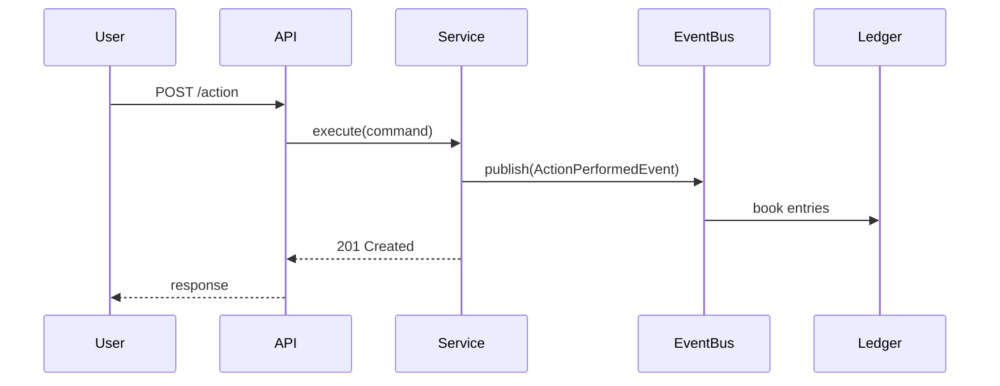

# /design — Design Loop (FDD Design by Feature)

The **Design** loop produces the technical design — the "how" — for a feature that has passed /refine. This is FDD's "Design by Feature" step: domain model updates, event flows, component design, API contracts, and NFR strategy. Design is done BEFORE test-and-develop, so Paul and Dmitri have clear guidance.

## Context Check (Before Starting)

Before starting design, verify:
- `docs/engagement/environments.md` — Target architecture and deployment topology
- `docs/engagement/codebase-patterns.md` — Full patterns (build, test, conventions, shared libs)
- `docs/engagement/test-data.md` — Data strategy (affects design of test interfaces)
- `docs/engagement/observability.md` — Monitoring tools and targets (affects instrumentation design)
- `docs/engagement/tech-debt.md` — Full debt map (design around fragile areas)
- `docs/engagement/team.md` — Architecture reviewers (who approves the design)

If ANY required context is missing → prompt User (see `/initiate` gap-fill protocol).

## Participants

| Role | Agent | Contribution |
|---|---|---|
| **Architect** | Dmitri | Component design, API contracts, event flows, data model |
| **Testability** | Paul | "How will I test this? What interfaces do I need?" |
| **Behavior** | Igor | Confirms design satisfies the refined scenarios |
| **Infrastructure** | Riley | "How does this deploy? What CI/CD changes? What environment config?" |
| **Navigator** | User | Approves design decisions, resolves trade-offs |

## Entry Criteria

- Feature has passed /refine (Definition of Ready met)
- All spikes resolved (no open unknowns)
- `backlog/ready/<slug>/feature.md` exists with scenarios

## Execution Model (MANDATORY)

**Four perspectives means four agents.** A single agent simulating other roles is NOT a design workshop — it is one perspective wearing multiple hats. The value of FDD's "Design by Feature" comes from genuinely different viewpoints colliding.

SM orchestrates /design by launching **separate agents** for each role:

```
Phase 1 — Independent design input (parallel):
  Agent: dmitri-developer     → Component design, API contracts, event flows, data model, NFR strategy
  Agent: paul-tester          → Testability assessment: "How will I test this? What interfaces do I need? What test infrastructure is missing? What wrappers, factories, or directory conventions must exist BEFORE /test-and-develop begins?"
  Agent: igor-product-owner   → Behavior validation: confirms design satisfies all refined scenarios, flags domain language issues
  Agent: riley-devops         → Infrastructure design: CI/CD gate changes, Docker updates, environment config, build dependency impacts, deployment strategy for this feature

Phase 2 — Cross-review (parallel):
  Each agent reads the other agents' Phase 1 output and responds:
  Dmitri reviews Paul's testability concerns, Igor's behavior validation, and Riley's infrastructure design
  Paul reviews Dmitri's component design, Igor's behavior validation, and Riley's infrastructure design
  Igor reviews Dmitri's component design, Paul's testability assessment, and Riley's infrastructure design
  Riley reviews Dmitri's component design, Paul's testability assessment, and Igor's behavior validation for infrastructure implications

Phase 3 — SM synthesizes + User gates:
  SM merges all input into the design artifact
  SM presents to User for approval: "Approved to build?"
```

**Anti-pattern:** Launching one agent (e.g., dmitri-developer) and asking it to also assess testability and validate behavior. This produces one technical perspective simulating other roles, missing genuine gaps.

**Why this matters:** Design decisions that look clean from an architecture perspective may be untestable or may not satisfy all refined scenarios. Independent perspectives catch these gaps before implementation starts — when they're cheap to fix.

## The Loop

```
┌─────────────────────────────────────────────────┐
│  1. Dmitri proposes domain model changes        │
│     - New/modified entities, aggregates         │
│     - Event flows (Mermaid sequence diagrams)   │
│     - API contracts (endpoints, payloads)       │
│     User: "Does this model feel right?"         │
│                                                 │
│  2. Paul reviews for testability                │
│     - "I need this interface to stub X"         │
│     - "This coupling makes testing hard"        │
│     - "Where do I inject test data?"            │
│     User: "Paul's concerns valid?"              │
│                                                 │
│  3. Igor validates against scenarios            │
│     - "Does this design satisfy scenario X?"    │
│     - "What about edge case Y?"                │
│     User: "Behavior preserved?"                 │
│                                                 │
│  4. NFR design decisions                        │
│     - Dmitri: "Here's how we meet perf target"  │
│     - Paul: "Here's how I'll verify it"         │
│     - Dmitri: "Here's the resilience strategy"  │
│     User: "Acceptable approach?"                │
│                                                 │
│  5. User approves design                        │
│     □ Approved → exit, ready for /test-and-develop│
│     □ Concerns → loop, address specific issue   │
│     □ Too complex → simplify or split feature   │
└─────────────────────────────────────────────────┘
```

## Design Artifacts

### Domain Model Update
```
Entities affected: [list]
New aggregates: [if any]
Relationships: [diagram]
Invariants: [business rules this design enforces]
```

### Event Flow (Mermaid)


### API Contract
```
POST /api/v1/<resource>
  Request: { field: type, ... }
  Response: { field: type, ... }
  Events: [ActionPerformedEvent]
  Errors: [400 validation, 409 conflict, 503 dependency unavailable]
```

### Component Design
```
Components:
  - <Resource>Controller — HTTP layer, validation
  - <Resource>Service — business logic, event publishing
  - <Resource>Repository — persistence
  - <Resource>EventHandler — downstream event reactions

Interfaces (for Paul's testability):
  - <Resource>Gateway (interface) — external dependency, stubbable
  - EventPublisher (interface) — event capture in tests
```

### Test Infrastructure Readiness (Paul's deliverable)

Paul must identify and document any test infrastructure needed BEFORE /test-and-develop begins:

```
Test infrastructure required:
  - Test file locations: [which directories, matching which config globs]
  - Required wrappers: [RouterTestWrapper, NestJS TestingModule, etc.]
  - Data factories needed: [list factories to create or extend]
  - Missing stubs/mocks: [external services that need stub infrastructure]
  - Reference test files: [existing tests in this package to use as templates]
```

If test infrastructure is missing (a new wrapper, a directory convention, a factory pattern), it is resolved during /design — not discovered during /test-and-develop. Test infrastructure surprises during implementation break the red-green-refactor rhythm.

**Why this exists:** In EOB-1, Paul discovered during /test-and-develop that frontend tests needed `RouterTestWrapper` and `__tests__/` subdirectories. This should have been identified in /design by reading existing test patterns.

### Deployment & Build Design (Riley's deliverable)

Riley must identify and document infrastructure impacts BEFORE /test-and-develop begins:

```
Deployment & Build:
  - CI/CD gate changes: [new stages, modified quality gates, new test suites to wire]
  - Docker updates: [new services, port changes, volume mounts, health check updates]
  - Environment config: [new env vars, secrets, feature flags per environment]
  - Build dependency impacts: [new packages, shared type exports, build order changes]
  - Deployment strategy: [rolling, blue/green, canary — and why]
  - Fresh clone verification: [will npm ci && npm run build:all still pass after this feature?]
```

If a feature introduces new packages, shared type exports, or environment variables, Riley documents them here so Dmitri and Paul don't discover them mid-implementation.

### NFR Strategy
```
Performance:
  - Approach: [caching / async / batch / index]
  - Paul verifies: [benchmark scenario from feature.md]

Security:
  - Approach: [RBAC / input validation / encryption]
  - Paul verifies: [security scenario from feature.md]

Resilience:
  - Approach: [circuit breaker / retry / fallback]
  - Paul verifies: [resilience scenario from feature.md]
```

## Outputs

```
backlog/ready/<feature-slug>/
  design.md               — Technical design document
  event-flow.md           — Mermaid sequence diagrams
  api-contract.md         — Endpoint specifications
  component-diagram.md    — Component structure + interfaces
  nfr-strategy.md         — How NFR targets will be met + tested
```

## Invocation

```bash
/design                        — Design the top refined (ready) item
/design <feature-slug>         — Design a specific refined feature
/design --review               — Review an existing design (e.g., after spike results)
```
